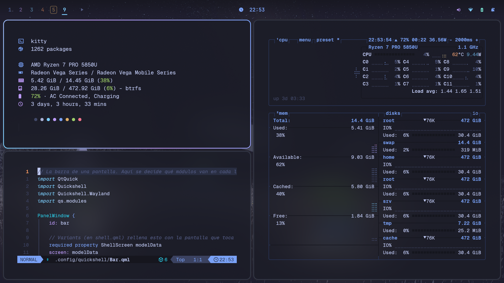
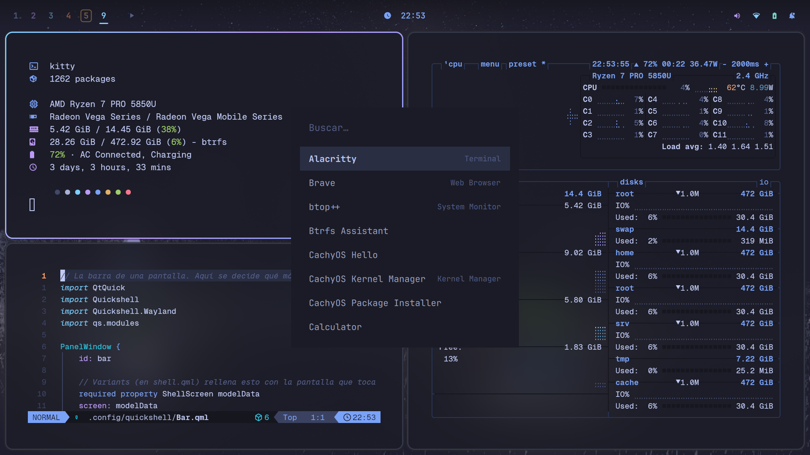
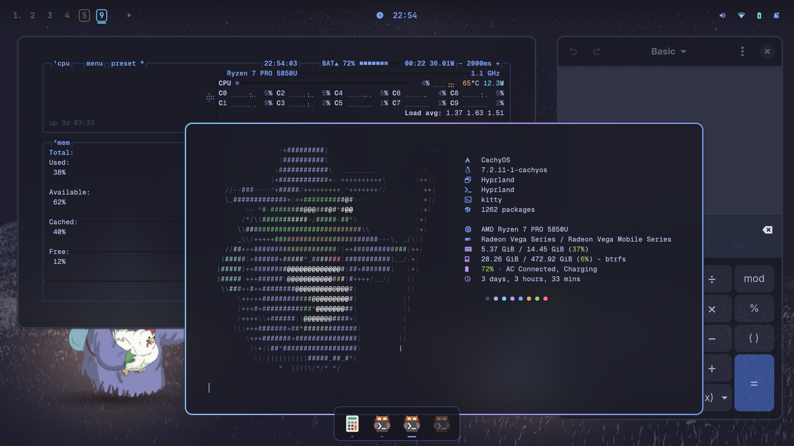

# dotfiles

My CachyOS desktop: **Hyprland** (Lua config) + **Quickshell** for everything else (bar, launcher, notifications, lock screen and dock).

Designed by me and implemented with help from [Claude Code](https://claude.com/claude-code).
[Omarchy](https://omarchy.org) was the inspiration for the desktop mode and the theme switcher.



## What's inside

- **Hyprland 0.56 with a Lua config** (`.config/hypr/hyprland.lua` + `config/*.lua`), dwindle tiling.
- **Quickshell** (`.config/quickshell`) replaces waybar, wofi, swaync, swayosd, hyprpaper and the polkit agent:
  bar, app launcher and menus (power, clipboard, emoji, themes, wifi and bluetooth via dmenu),
  notifications, volume and brightness OSD, wallpaper, lock screen and polkit dialog.
- **Per-workspace desktop mode**: on the workspaces you pick, windows float, can be minimized
  and a dock shows up at the bottom. In the bar, those workspaces have their number inside a box.
- **Color theme switcher** (`.config/themes`): one `theme.json` per theme that
  colors Hyprland, Quickshell, hyprlock, kitty, btop, GTK, fzf and Neovim at once.
  Ships with miami, catppuccin, tokyo-night, rose-pine, gruvbox and vantablack.
- Neovim with LazyVim, kitty, btop and fastfetch.



### Desktop mode



- **Super+Alt+D** turns it on or off for the current workspace. New windows open floating, centered and at 65% of the screen.
- **Super+M** minimizes the window.
- **Dock**: click a window to bring it to the front; click the active one to minimize it; click a minimized one to restore it.
- Moving a window to a normal workspace puts it back in tiling.

It lives in `.config/hypr/config/desktopmode.lua` and `.config/quickshell/modules/Dock.qml`.

## Keybindings

| Keys | Action |
|---|---|
| Super+Space | App launcher |
| Super+Enter | Terminal (kitty) |
| Super+F | Files (Dolphin) |
| Super+W | Close window |
| Super+H/J/K/L | Move focus |
| Super+Shift+H/J/K/L | Move window |
| Super+1…0 | Go to workspace |
| Super+Shift+1…0 | Send window to workspace |
| Super+D | Fullscreen |
| Super+Alt+Space | Toggle floating |
| Super+Alt+J | Toggle split direction |
| Super+Alt+D | Desktop mode on this workspace |
| Super+M | Minimize |
| Alt+Tab | Next window |
| Super+S / Super+Shift+S | Scratchpad: show / send window |
| Super+Esc | Power menu |
| Super+Ctrl+V | Clipboard history |
| Super+. | Emoji |
| Super+Ctrl+T | Switch theme |
| Super+A | Notification center |
| Super+Alt+L | Lock |
| Super+Shift+P | Screenshot a region |
| Super+C / Super+V | Copy / paste in any app |

Workspace numbers are bound by keycode, so they also work on AZERTY keyboards.

## Installation

There's no script: copy whatever you want into your `~`.

```sh
git clone https://github.com/artiimor/dotfiles.git
cp -r dotfiles/.config/* ~/.config/
```

Packages it uses: `hyprland` (0.56 or newer, for the Lua config), `quickshell`, `uwsm`, `kitty`, `hypridle`,
`hyprlock` (as a fallback), `hyprsunset`, `hyprshot`, `cliphist`, `wl-clipboard`, `brightnessctl`, `playerctl`,
`wireplumber`, `power-profiles-daemon`, `networkmanager-dmenu`, `bzmenu`, `pavucontrol`, `btop`, `fastfetch`,
`neovim`, `python` (for `theme-set`) and the `ttf-jetbrains-mono-nerd` font.

Things you'll probably want to change:

- `.config/hypr/config/variables.lua`: default apps and monitor names.
- `.config/hypr/config/inputs.lua`: keyboard layout. On the ThinkPad keyboard I have Alt and Super swapped.
- `.config/quickshell/Theme.qml`: the wallpaper path.
