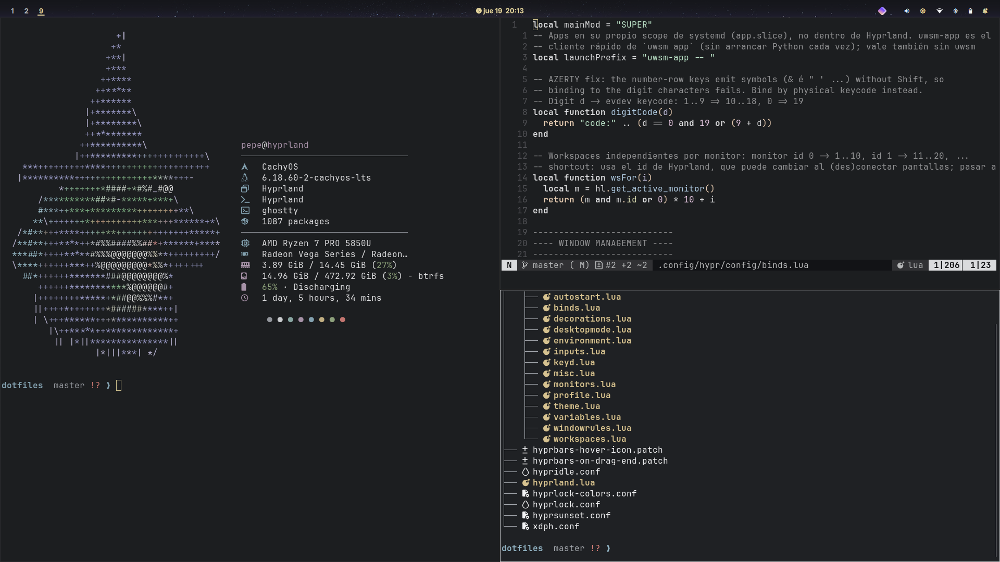
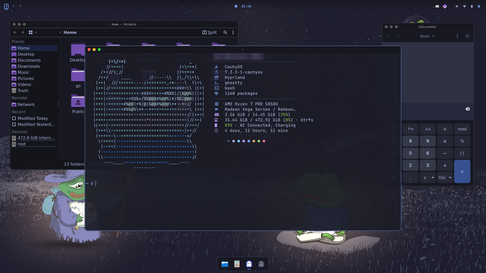
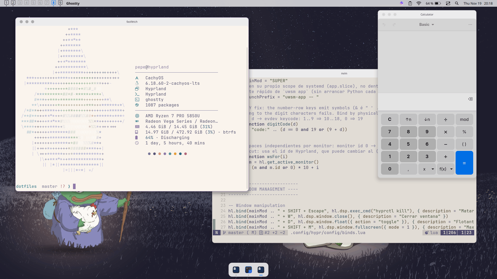
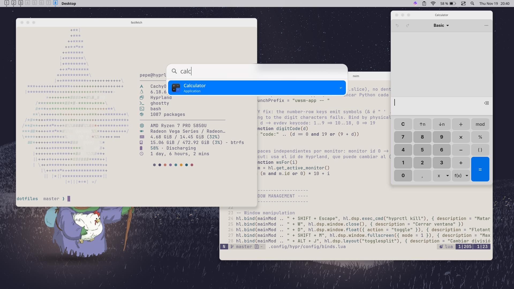
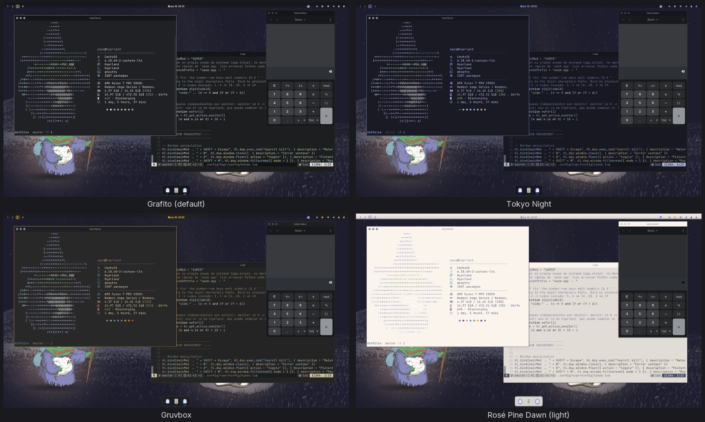
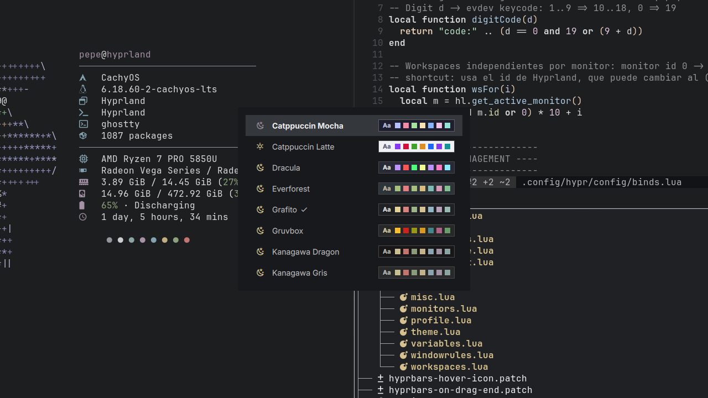
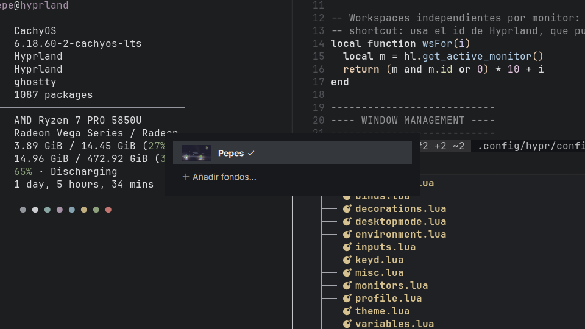
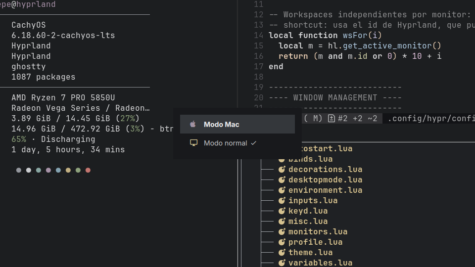
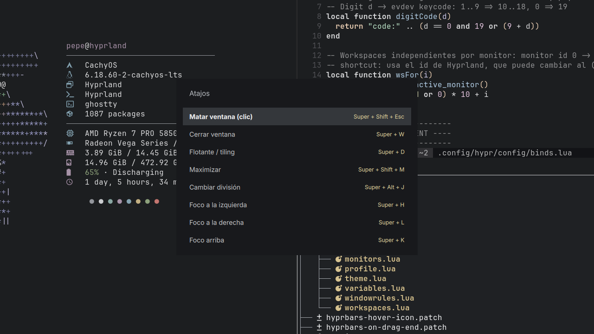

# dotfiles

My **Hyprland** desktop for **CachyOS / Arch Linux**: Hyprland with a Lua config, and **Quickshell** for everything else
(bar, launcher, menus, notifications, OSD, wallpaper, lock screen, polkit dialog and dock).
Two looks, switchable live: a tiling **Normal mode** and a floating, macOS-style **Mac mode**, with 18 color themes on top.


Designed by me and implemented with help from [Claude Code](https://claude.com/claude-code).
[Omarchy](https://omarchy.org) inspired the desktop mode, the theme switcher and the per-theme backgrounds.

```sh
git clone https://github.com/artiimor/dotfiles.git ~/dotfiles && ~/dotfiles/install.sh
```

## Contents

- [Tour](#tour)
- [Features](#features)
- [Requirements](#requirements)
- [Installation](#installation)
- [Desktop profiles: Mac mode / Normal mode](#desktop-profiles-mac-mode--normal-mode)
- [Color themes](#color-themes)
- [Backgrounds](#backgrounds)
- [Desktop mode (floating workspaces)](#desktop-mode-floating-workspaces)
- [Keybindings](#keybindings)
- [Keyboard remapping (keyd)](#keyboard-remapping-keyd)
- [Repository structure](#repository-structure)
- [Customizing](#customizing)
- [Languages](#languages)
- [Updating and re-applying](#updating-and-re-applying)
- [Uninstalling / reverting](#uninstalling--reverting)
- [Tests](#tests)
- [Troubleshooting](#troubleshooting)
- [Credits and third-party assets](#credits-and-third-party-assets)

## Tour

"Super" below is whatever key Hyprland receives as Super. With the bundled keyd config it's the physical left **Alt** key
(see [keyd](#keyboard-remapping-keyd)).

### Tiling (Normal mode)



Dwindle tiling with square corners and the Quickshell top bar; every workspace starts tiling.
**Super+Enter** opens a terminal, **Super+H/J/K/L** moves focus, **Super+B** hides or shows the bar.
The bar has no background by default and its icons turn light or dark to match the wallpaper;
double-click an empty spot on it to toggle a solid background (remembered across restarts).

### Floating workspaces (desktop mode)



**Super+Alt+D** turns the current workspace into a floating desktop: macOS-style titlebars, minimize,
edge snapping and an auto-hiding dock at the bottom. The workspace number gets a box in the bar.
[Details](#desktop-mode-floating-workspaces).

### Mac mode, dark and light

| Dark | Dark, Spotlight (Super+Space) |
|---|---|
|  |  |
| **Light** | **Light, Spotlight (Super+Space)** |
|  |  |

The second profile: the macshell top bar, Spotlight, rounded corners and shadows,
and every workspace floating. A light color theme turns it light automatically.
Switch profiles with **Super+Shift+T**. [Details](#desktop-profiles-mac-mode--normal-mode).

### Theme switching



One `theme.json` per theme recolors Hyprland, Quickshell, the terminals, Neovim, GTK, Qt and more at once.
**Super+T** opens the picker; each row shows the palette and a sun or moon for light or dark. [Details](#color-themes).



### Launcher, backgrounds and menus

| Launcher (Super+Space) | Background picker (Super+Ctrl+B) |
|---|---|
|  |  |
| **Profile menu (Super+Shift+T)** | **Keybinding cheatsheet (Super+/)** |
|  |  |

App launcher, clipboard history, emoji picker, power menu, file search, the theme / background / profile menus and the
cheatsheet are all the same Quickshell launcher in different modes. Their labels follow your [language](#languages).

## Features

- **Hyprland 0.57+ with a Lua config** (`.config/hypr/hyprland.lua` + `config/*.lua`): dwindle tiling,
  10 independent workspaces per monitor, touchpad gestures, gaming workspace rules, zoom.
- **Quickshell** (`.config/quickshell`) replaces waybar, wofi, swaync, swayosd, hyprpaper, hyprlock and the polkit agent:
  bar, app launcher and menus (power, power profiles, clipboard, emoji, themes, backgrounds, profiles, keybinding cheatsheet,
  file search, Wi-Fi via `networkmanager_dmenu` and Bluetooth via `bzmenu`), notifications, volume/brightness OSD, night light
  (hyprsunset), wallpaper, lock screen and polkit dialog. `hyprlock` stays as a fallback. Laptop or desktop is detected at runtime:
  the battery indicator only shows when UPower reports a laptop battery, and brightness (bar, sliders, OSD, keys) only when
  there is a panel in `/sys/class/backlight`, in both profiles. On a laptop, a notification warns at 15% battery and a
  critical one at 5% (both profiles).
- **Two desktop profiles**, *Mac mode* and *Normal mode*, switchable live with **Super+Shift+T** (`config-set`).
- **Per-workspace desktop mode** (**Super+Alt+D**): floating windows, minimize, a dock and macOS-style edge snapping.
- **macOS-style titlebars** (close / minimize / maximize) on floating windows, using a patched `hyprbars` plugin.
- **Color theme switcher** (**Super+T**, `theme-set`): one `theme.json` per theme recolors Hyprland, Quickshell, hyprlock,
  Ghostty, kitty, btop, fzf, GTK, Qt/KDE, fastfetch and running Neovim instances at once. 18 themes, 4 of them light.
- **Monospace font picker** (**Super+T**, "Font" tab, `font-set`) for kitty, Ghostty and the Normal mode titlebars.
- **Increase contrast** (`contrast-set`, Control Center tile in Mac mode, bar button in Normal mode): opaque, thicker borders, no blur, purer text, GTK high contrast and stronger terminal/Neovim colors.
- **Per-theme backgrounds** (**Super+Ctrl+B**, `background-set`), remembered per theme.
- **Main menu** (**Super+M**), like Omarchy's. For now it has *Style*: theme, font, background, profile and increase
  contrast in one place; in Mac mode Super+M opens macshell's Appearance window directly. Navigate with the arrows or hjkl:
  Right / l opens a submenu, Left / h goes back.
- **Terminal setup**: Ghostty, bash + starship, a minimal Neovim built on mini.nvim (colors generated from the theme with
  mini.hues; LazyVim, available as `lazyvim`, shares the same colors and keeps `miami` and `basalt` colorschemes),
  btop, eza/bat/fzf aliases, fastfetch with an ASCII Pepe tinted with the theme accent.
- **System extras** (optional, under `system/`): greetd + ReGreet login screen, the "sobrio" Plymouth boot theme (plain neutral gray),
  a keyd config for a ThinkPad keyboard, automatic time zone from the network and 10 password attempts before lockout (faillock).
- **Web apps** (`.local/share/applications`): Proton Mail, Proton Calendar, Proton Drive, WhatsApp and YouTube as Brave app windows.
  "Create webapp" and "Remove webapp" in the launcher (and Spotlight) add or remove your own (`quickshell/scripts/webapp`).

## Requirements

- **CachyOS or Arch Linux** (the installer needs `pacman`; it refuses to run without it).
- **Hyprland 0.57 or newer** (the config is Lua, which older versions don't support).
- A normal user with `sudo`. Don't run the installer as root (it refuses).
- Internet access: packages, the AUR packages `bzmenu` and `whitesur-icon-theme`, the macOS cursor download and the `hyprland-plugins` clone for `hyprbars`.

## Installation

```sh
git clone https://github.com/artiimor/dotfiles.git ~/dotfiles
~/dotfiles/install.sh          # asks before each step (Enter = yes)
~/dotfiles/install.sh --yes    # does everything without asking (-y also works)
```

The script is safe to re-run: `pacman` uses `--needed`, overwritten files are backed up, and your own
`monitors.lua`, `variables.lua`, `inputs.lua`, user files (below) and chosen theme are kept if they already exist.
It asks for `sudo` once at the start and keeps it alive. A failed package, AUR build or download is only a warning.
Its prompts follow your [language](#languages) (`[Y/n]`: `y`/`s` or Enter means yes).

When it finishes, reboot and pick the **Hyprland (uwsm-managed)** session.

### What `install.sh` does

| Step | What happens |
|---|---|
| **1. Desktop packages** | `pacman -Syu`, then installs the desktop, terminal, font and login/boot package groups (see the list below). Packages missing from your repos (e.g. CachyOS-only ones on plain Arch) are reported and tried from the AUR; if a batch conflicts, it retries one by one. `bzmenu` and `whitesur-icon-theme` come from the AUR via `paru`/`yay` if present, otherwise `makepkg`. |
| **1b. GPU** | Detects the graphics cards from PCI (`/sys/bus/pci/devices`). Intel: offers `intel-media-driver` (VA-API). NVIDIA: if `nvidia-utils` is already installed (CachyOS does it with `chwd`) nothing is installed; on CachyOS without drivers it offers `chwd -a`; on plain Arch it offers `nvidia-open-dkms nvidia-utils egl-wayland libva-nvidia-driver` plus the headers of each installed kernel that are in your repos (`nvidia-open` needs Turing/RTX 20 or newer, so this question defaults to no and is asked even with `--yes`). If NVIDIA is the primary GPU (the only one, or the boot GPU) and `nvidia-utils` is installed, it writes `LIBVA_DRIVER_NAME`, `__GLX_VENDOR_LIBRARY_NAME` and `NVD_BACKEND` to `~/.config/uwsm/env.d/gpu`; on hybrid laptops (Intel/AMD iGPU + NVIDIA) it doesn't, since forcing them breaks the session. The file is regenerated on every run. |
| **2. Extra apps** (optional) | `firefox brave-bin spotify-launcher discord proton-pass proton-vpn-gtk-app claude-code github-cli`, installed the same way as step 1. |
| **3. Dotfiles** | Copies `.config/` → `~/.config/`, `.local/share/applications/` (web apps) → `~/.local/share/applications/`, `.local/share/icons/` (Sur icons) → `~/.local/share/icons/`, and `.bashrc`, `.bash_profile`, `.profile` → `~`. Details below. |
| **3b. Shell** | If your login shell isn't bash (CachyOS defaults to fish), offers `chsh -s /bin/bash`. |
| **4. Theme and profile** | Runs `theme-set <theme>` (your current theme if you already had one, otherwise **grafito**) and `config-set --reapply` (keeps your profile; Mac mode on a fresh install). |
| **5. hyprbars** | Clones `hyprwm/hyprland-plugins` at the tag matching your installed Hyprland (falls back to `vX.Y.0`), applies the four patches in `.config/hypr/`, builds it and copies `hyprbars.so` to `~/.local/lib/hyprland/`. Then offers to remove the apps' own window buttons (GTK `button-layout`, and Brave's "use system title bar", only if Brave is closed). |
| **6. System (sudo)** | Each part is asked separately: **greetd + ReGreet** (installs `system/etc/greetd/*` and the greeter background, sets the greeting to your hostname and the clock's locale and date format to the system's date locale (`LC_TIME`, or else `LANG`, from `localectl`), disables whatever display manager is active and enables greetd); **Plymouth "sobrio"** (copies the theme, sets it as default and regenerates the initramfs with `limine-mkinitcpio` or `mkinitcpio -P`); **keyd** (installs `system/etc/keyd/thinkpad.conf`: Alt/Super swap and CapsLock as Control; enables keyd and adds you to the `keyd` group. The default answer depends on the hardware: yes if a ThinkPad is detected via DMI, no otherwise, and `--yes` follows that default); **automatic time zone** (installs the NetworkManager dispatcher script `system/etc/NetworkManager/dispatcher.d/90-timezone` and enables `NetworkManager-dispatcher`: on each connection it sends your public IP to ipinfo.io and sets the time zone it returns; it does nothing while a VPN is active); **password attempts** (installs `system/etc/security/faillock.conf` with `deny = 10`: 10 failed passwords lock the account for 10 minutes, instead of 3; it affects sudo and the lock screen); **services** (enables NetworkManager, bluetooth and power-profiles-daemon). Files it replaces under `/etc` are backed up to `~/.dotfiles-old/<timestamp>/system/etc/...`. |

Details of step 3:

- **Backups**: every file it would overwrite is first saved to `~/.dotfiles-old/<YYYYmmdd-HHMMSS>/`, keeping the same
  relative path (e.g. `~/.dotfiles-old/20261119-120000/.config/hypr/hyprland.lua`). Copying is done with
  `rsync -a --backup`, so nothing in your `~/.config` is deleted, only overwritten. `hypr/config/monitors.lua`,
  `variables.lua`, `inputs.lua`, `themes/current` and the user files are only copied if you don't have them yet.
- **Your own changes**: put them in `~/.config/hypr/config/user.lua`, `~/.config/ghostty/user.ghostty` and
  `~/.config/nvim/lua/user.lua`. They are loaded last, so they win over the defaults; the installer creates them
  (with commented examples) on the first run and never overwrites them. Everything else in `~/.config`, Quickshell and the themes
  included, is overwritten on re-install (with the old copy in `~/.dotfiles-old`).
- **Monitors**: on a first install (no `monitors.lua` yet) it writes one with a rule per connected output, read
  from `hyprctl monitors` if Hyprland is running or from `/sys/class/drm` otherwise. Scale is a guess from the
  resolution (internal panel ≥ 2560 wide → 1.6, ≥ 3200 → 2; external 4K → 1.5; `auto` if it wouldn't divide evenly),
  plus a catch-all rule (`preferred`, `auto`, scale `auto`) for anything plugged in later. If nothing is detected
  the repo's catch-all-only file stays, which works on any machine.
- **Home path**: the few files that need an absolute path (`networkmanager-dmenu/config.ini` and the web app
  `.desktop` files) contain an `@HOME@` placeholder. The installer replaces it with your `$HOME` in those files only.
- **Cursor**: downloads the black macOS cursor ([apple_cursor](https://github.com/ful1e5/apple_cursor) v2.0.1) into
  `~/.local/share/icons/macOS` and checks its SHA-256. If the download fails it switches GTK, `uwsm/env` and `hypr/config/environment.lua`
  to Adwaita instead. It also writes `~/.icons/default/index.theme` (for X11 apps) and sets the GNOME cursor setting.
- Makes `theme-set`, `config-set`, `background-set`, `font-set` and the Quickshell scripts executable, and runs `xdg-user-dirs-update`.

### Packages

| Group | Packages |
|---|---|
| Desktop | `hyprland quickshell uwsm xdg-desktop-portal-hyprland hypridle hyprlock hyprsunset hyprshot hyprpicker grim slurp cliphist wl-clipboard brightnessctl playerctl ddcutil pipewire-pulse wireplumber pavucontrol power-profiles-daemon upower networkmanager networkmanager-dmenu bluez bluez-utils gnome-keyring seahorse libnotify xdg-user-dirs unicode-emoji dolphin kde-cli-tools ffmpegthumbs ffmpegthumbnailer qview gnome-calculator gnome-text-editor swash qt6ct breeze nwg-look adw-gtk-theme papirus-icon-theme fd libqalculate python-gobject` |
| Terminal | `ghostty kitty starship btop fastfetch bash-completion fzf eza bat neovim lazygit ripgrep tree-sitter-cli nodejs npm micro python python-defusedxml git base-devel rsync` |
| Fonts | `ttf-jetbrains-mono-nerd otf-geist-mono-nerd ttf-firacode-nerd ttf-hack-nerd ttf-cascadia-code-nerd ttf-iosevka-nerd ttf-meslo-nerd ttf-sourcecodepro-nerd ttf-ubuntu-mono-nerd ttf-victor-mono-nerd otf-commit-mono-nerd ttf-mononoki-nerd ttf-zed-mono-nerd ttf-ibmplex-mono-nerd otf-monaspace-nerd ttf-0xproto-nerd ttf-martian-mono-nerd ttf-roboto-mono-nerd inter-font cantarell-fonts noto-fonts noto-fonts-emoji noto-fonts-cjk` |
| Login / boot | `greetd greetd-regreet cage plymouth keyd` |
| AUR | `bzmenu whitesur-icon-theme` |

### Manual install

If you'd rather copy only some pieces:

```sh
cp -r ~/dotfiles/.config/* ~/.config/
cp ~/dotfiles/.bashrc ~/dotfiles/.bash_profile ~/dotfiles/.profile ~/
~/.config/themes/theme-set grafito          # or any other theme: generates the color files
~/.config/themes/config-set default         # or "mac"
```

Then replace the `@HOME@` placeholder yourself:
`grep -rlI '@HOME@' ~/.config ~/.local/share/applications | xargs -r sed -i "s|@HOME@|$HOME|g"`.

## Desktop profiles: Mac mode / Normal mode

**Super+Shift+T** opens the "Config" menu with *Mac mode* and *Normal mode* (the active one has a check mark). From a terminal:

```sh
~/.config/themes/config-set mac       # Mac mode (Mac light if the color theme is light)
~/.config/themes/config-set default   # Normal mode (also accepts "normal")
~/.config/themes/config-set           # list the profiles (* = active)
~/.config/themes/config-set --reapply # re-apply the current one
```

It applies in a couple of seconds without logging out: reloads Hyprland, restarts Quickshell and rewrites the GTK, Qt
and KDE icon/style settings. Apps that are already open pick up new icons and Qt style when reopened.

| | Mac mode (`mac`) | Normal mode (`default`) |
|---|---|---|
| Bar and notifications | macshell: macOS-style top bar, control center, notification center | Quickshell bar, notifications and notification center from this repo |
| Super+Space | Spotlight (macshell): apps, calculator and files | App launcher |
| Super+Esc / Super+A | macshell power menu / control center | Power menu / notification center |
| Super+B | not bound (the bar belongs to macshell) | Show / hide the top bar |
| Windows | 10 px rounded corners and a soft shadow | Square corners, default shadow |
| Titlebars (hyprbars) | macOS gray, Noto Sans, 32 px | Theme colors, the [chosen font](#font) (JetBrains Mono by default), 28 px |
| Icons (GTK, Qt, Dolphin) | Sur-Transparente (Sur with a light theme) | Papirus-Dark (Papirus-Light with a light theme) |
| Qt apps (qt6ct) | Breeze, `mac-dark` colors, Noto Sans | Fusion, colors from the active theme |
| Workspaces | All floating (desktop mode); Super+Alt+D makes one tiling | All tiling; Super+Alt+D makes one floating |

Shared by both: the color theme, desktop mode, the rest of the keybindings, the macOS cursor, keyd and
Super+Shift+Space for the Quickshell app launcher. In Mac mode the color theme doesn't recolor Qt apps or the
titlebars (they keep the macOS gray), and the Quickshell menus, OSD, polkit dialog and dock copy macshell's look.

### Light and dark: `mac-light`

Light or dark is decided by the **color theme** (`"light": true` in its `theme.json`), not by the profile:

- In Mac mode, a light theme switches to the internal profile **`mac-light`**: light macshell and titlebars, Sur icons,
  light GTK (`adw-gtk3` + `prefer-light` with a fixed light `gtk.css` that `theme-set` doesn't overwrite) and the
  `mac-light` Qt colors. A dark theme switches back to `mac`. `theme-set` does this automatically when you change
  themes, and `config-set mac` with a light theme already saves `mac-light`. `config-set mac-light` forces it by hand
  until the next theme change or `--reapply`.
- In Normal mode, a light theme makes GTK light (`adw-gtk3` + `prefer-light`, with the theme's `gtk.css`) and uses
  Papirus-Light icons; everything else already takes the theme's colors.

### Where it's stored, and macshell

The active profile is saved in `~/.local/state/desktop-profile` and read by `hypr/config/profile.lua` and
`quickshell/shell.qml`. Without that file the default is `mac`.

**macshell** is a standalone Quickshell config in `.config/quickshell/macshell/` (started with `qs -p`). Its icons are
`Sur` and `Sur-Transparente` (in `.local/share/icons`), built on top of WhiteSur (AUR `whitesur-icon-theme`).
If `~/.config/quickshell/macshell/shell.qml` is missing, `mac` / `mac-light` behave exactly like `default`.

## Color themes

**Super+T** opens the theme menu, split into two tabs, **Dark** and **Light**, plus a third, **Font**
([font](#font)); it opens on the active theme's tab with that theme selected. Switch tabs by clicking, with Tab / Shift+Tab or with ←/→. Each tab has its own search (just type; it is kept per tab), and fonts also match their original name (e.g. "Cascadia" finds CaskaydiaCove). From a terminal:

```sh
~/.config/themes/theme-set              # list themes (* = active)
~/.config/themes/theme-set miami        # apply a theme (its folder name)
~/.config/themes/theme-set --reapply    # regenerate the current theme after editing its theme.json
```

| Folder | Name | Type | Neovim colorscheme |
|---|---|---|---|
| `basalt` | Basalt | dark | basalt |
| `catppuccin-frappe` | Catppuccin Frappé | dark | catppuccin-frappe |
| `catppuccin-latte` | Catppuccin Latte | **light** | catppuccin-latte |
| `catppuccin-macchiato` | Catppuccin Macchiato | dark | catppuccin-macchiato |
| `catppuccin-mocha` | Catppuccin Mocha | dark | catppuccin-mocha |
| `dracula` | Dracula | dark | dracula |
| `everforest` | Everforest | dark | everforest |
| `grafito` | Grafito (installer default) | dark | dracula |
| `gruvbox` | Gruvbox | dark | gruvbox |
| `kanagawa-dragon` | Kanagawa Dragon | dark | kanagawa-dragon |
| `kanagawa-gris` | Kanagawa Gris | dark | kanagawa-dragon |
| `miami` | Miami night | dark | miami |
| `obsidian` | Obsidian (greyscale) | dark | basalt |
| `rose-pine` | Rosé Pine | dark | rose-pine |
| `rose-pine-dawn` | Rosé Pine Dawn | **light** | rose-pine-dawn |
| `snow` | Snow (greyscale) | **light** | default |
| `terminal-clasico` | Terminal Clásico (macOS Terminal "Basic" + classic Vim syntax) | **light** | vim |
| `tokyo-night` | Tokyo Night | dark | tokyonight |

`~/.config/themes/current` is a symlink to the active theme. What `theme-set` writes and when each app picks it up:

| App | File | Applies |
|---|---|---|
| Quickshell | reads `themes/current/theme.json` | immediately |
| Hyprland | `hypr/config/theme.lua` | immediately |
| kitty / Ghostty | `kitty/themes/current.conf`, `ghostty/themes/current` | immediately |
| Neovim | shared `tema` colorscheme (also used by `lazyvim`): mini.hues from `ui.bg`/`ui.fg`, syntax from `nvimColors.syn`, and the whole UI (line numbers, cursorline, selection, menus, floats, statusline, search, diagnostics, diff) from the theme's `ui`/`term` palette, optionally overridden by `nvimColors.ui`; sent to running instances over their socket | immediately |
| Background | asked from `background-set` | immediately |
| btop | `btop/themes/current.theme` | next launch |
| GTK | `gtk-3.0/gtk.css`, `gtk-4.0/gtk.css` (not in `mac-light`) | next launch of the app |
| Qt / KDE | `qt6ct/colors/current.conf`, `kdeglobals` | next launch of the app |
| fzf | `themes/current-env.sh` (sourced by `~/.bashrc`) | new terminals |
| fastfetch | `fastfetch/themed/pepe-*.txt` | new terminals |
| hyprlock | `hypr/hyprlock-colors.conf` | next lock (fallback only) |

Generated files start with `Generado por theme-set`: don't edit them, edit the theme's `theme.json` and run `--reapply`.
The login screen (ReGreet, macOS-style dark gray) and Plymouth ("sobrio") are outside the theme system.

**Creating a theme**: copy a folder (`cp -r ~/.config/themes/miami ~/.config/themes/my-theme`), change `name` and the
colors in its `theme.json` (add `"light": true` for a light theme) and pick it with Super+T.
The meaning of each `theme.json` section is documented in [`.config/themes/README.md`](.config/themes/README.md).

### Font

The monospace font is separate from the color theme: pick it in the **Font** tab of Super+T (each row is written in
its font) or with `~/.config/themes/font-set "<family>"` (no argument lists the installed Nerd Fonts). It applies at once
to kitty, Ghostty and the hyprbars titlebars in Normal mode, and is saved in `~/.local/state/font`. The Quickshell UI
(Inter, or Noto Sans in Mac mode) keeps its own font. Details in [`.config/themes/README.md`](.config/themes/README.md#fuente).

### Increase contrast

Like macOS's *Increase contrast*: thicker, opaque window borders, no blur, pure black/white titlebar text, more marked
secondary text and bar borders in Quickshell, GTK/libadwaita high contrast, and slightly stronger colors in the
terminals and Neovim. It works with any theme and both profiles.
Toggle it from the **Increase Contrast** tile of the Control Center (Mac mode), the contrast button in the bar next to
Night light and Keep awake (Normal mode), or with `~/.config/themes/contrast-set on|off|toggle` (no argument prints
`on`/`off`). It's saved in `~/.local/state/increased-contrast`. Details in
[`.config/themes/README.md`](.config/themes/README.md#increase-contrast).

## Backgrounds

Like in Omarchy, every theme can ship its own wallpapers in `~/.config/themes/<theme>/backgrounds/`
(`jpg`, `jpeg`, `png`, `webp`, `bmp`, `gif`). The default "Pepes" meadow wallpaper is always appended at the end of the list.
No theme in the repo ships backgrounds yet, so out of the box you get the Pepes.

| Keys | Action |
|---|---|
| **Super+Ctrl+B** | Background picker with thumbnails for the current theme |
| **Super+Ctrl+Shift+B** | Next background of the current theme |

```sh
~/.config/themes/background-set              # list: name, path, 1 if active
~/.config/themes/background-set foo.jpg      # set a background by file name ("pepes" for the default)
~/.config/themes/background-set --next       # next one
~/.config/themes/background-set --path       # path of the active one
```

**Adding backgrounds**: choose **"＋ Add wallpapers…"** at the bottom of the Super+Ctrl+B picker; it creates and opens the
current theme's `backgrounds/` folder in the file manager, so you can drop images in. Or copy them there by hand.

The choice is remembered per theme in `~/.local/state/theme-backgrounds`. With nothing chosen (or if the chosen file
is gone), the first one in the list is used.

## Desktop mode (floating workspaces)

- **Super+Alt+D** toggles desktop mode on the current workspace. In Normal mode every workspace starts tiling and
  Super+Alt+D makes it floating; in Mac mode every numbered workspace starts floating and Super+Alt+D makes it tiling.
  Desktop-mode workspaces have their number inside a box in the bar.
- New windows open floating, centered, at 65% of the screen.
- The middle titlebar button minimizes the window to `special:minimized`.
- **Dock** (auto-hides, hover the bottom edge): click a window to bring it to the front, click the active one to
  minimize it, click a minimized one to restore it.
- **Snapping**: drop a window against the left or right edge for half the screen, or against the top to maximize.
  Dragging a half-screen window away restores its size. Double-clicking the titlebar toggles maximize.
- Moving a window to a tiling workspace puts it back into tiling (windows that float because of a window rule stay floating).
- Each profile remembers its own exceptions in `~/.local/state/desktop-exceptions-mac` and
  `~/.local/state/desktop-workspaces-default`; open windows adapt when you switch profiles.
  The resulting list is written to `~/.local/state/desktop-workspaces` for Quickshell.

Code: `.config/hypr/config/desktopmode.lua` and `.config/quickshell/modules/Dock.qml`.

The titlebars come from `hyprbars` built with the four local patches
(`hyprbars-on-drag-end.patch` adds the drag hooks used by snapping, `hyprbars-hover-icon.patch` shows the button
symbol on hover, `hyprbars-resize-top-edge.patch` lets the top edge of the bar resize the window, `hyprbars-separator.patch` adds `col.separator`, the line under the bar used by Increase contrast). `install.sh` builds it;
the manual steps are also in a comment at the end of `desktopmode.lua`.
Without the plugin everything else still works, just without titlebars.

## Keybindings

**Super+/** shows the cheatsheet on screen. All of these come from `.config/hypr/config/binds.lua` and
`desktopmode.lua`. "Super" is whatever key Hyprland receives as Super; on the ThinkPad keyd config it's the physical
left **Alt** key (see [keyd](#keyboard-remapping-keyd)).

### Apps and menus

| Keys | Action |
|---|---|
| Super+Space | App launcher (Spotlight in Mac mode) |
| Super+Shift+Space | Quickshell app launcher (both profiles) |
| Super+Alt+Space | Quickshell app launcher; the app opens in a floating window |
| Super+Enter | Terminal (Ghostty) |
| Super+F | File manager (Dolphin) |
| Super+Ctrl+T | Text editor (GNOME Text Editor) |
| Super+Shift+C / XF86Calculator | Calculator (GNOME Calculator) |
| Ctrl+Shift+Esc | System monitor (btop in a terminal) |
| Super+Esc | Power menu (macshell's in Mac mode) |
| Super+A | Notification center (macshell's control center in Mac mode) |
| Super+B | Show / hide the top bar (Normal mode only) |
| Super+Ctrl+V | Clipboard history |
| Super+. | Emoji picker |
| Super+T | Color theme and font menu |
| Super+Shift+T | Profile menu (Mac mode / Normal mode) |
| Super+Ctrl+B | Background picker |
| Super+Ctrl+Shift+B | Next background |
| Super+M | Main menu (Style: theme, font, background, profile, contrast); Appearance window in Mac mode |
| Super+/ | Keybinding cheatsheet |
| Super+Shift+P | Screenshot of a region (hyprshot) |
| Super+Ctrl+L | Lock screen |

### Windows

| Keys | Action |
|---|---|
| Super+W | Close window |
| Super+Shift+Esc | Kill a window (click it) |
| Super+H / J / K / L | Move focus left / down / up / right |
| Super+Shift+H / J / K / L | Move window left / down / up / right |
| Super+Alt+H / J / K / L | Resize window: narrower / taller / shorter / wider (50 px, hold to repeat) |
| Super+D | Toggle floating / tiling |
| Super+Shift+M | Maximize (toggle) |
| Super+Ctrl+J | Toggle split direction |
| Super+Alt+D | Toggle desktop mode on this workspace |
| Alt+Tab | Next window (brings it to the front) |
| Super+Left drag | Move window |
| Super+Right drag | Resize window |
| Super+C / Super+V / Super+X | Copy / paste / cut in any app (sent as Ctrl+Insert / Shift+Insert / Ctrl+X) |
| Super+Plus / Super+Minus (also keypad + / −) | Zoom in / out (1x to 3x) |

### Workspaces and monitors

| Keys | Action |
|---|---|
| Super+1 … 0 | Go to workspace 1–10 of the current monitor |
| Super+Shift+1 … 0 | Move window to that workspace and follow it |
| Super+Shift+Alt+1 … 0 | Move window to that workspace without following |
| Super+Alt+1 … 0 | Go to workspace 11–20 (e.g. left over from a disconnected monitor), only if it has windows |
| Super+Scroll (Super+Ctrl+Scroll reversed) | Previous / next workspace |
| Super+Tab | Focus the next monitor |
| Super+Shift+Tab | Move window to the other monitor's active workspace |
| Super+S | Show / hide the scratchpad |
| Super+Shift+S | Send window to the scratchpad |

Each monitor has its own workspaces: monitor 0 uses 1–10, monitor 1 uses 11–20, and so on. Number keys are bound by
keycode, so they also work on AZERTY layouts.

### Hardware keys and gestures

| Input | Action |
|---|---|
| Volume up / down / mute, mic mute | `wpctl` (volume capped at 100%, OSD shown by Quickshell) |
| Play / pause / next / previous | `playerctl` |
| Brightness up / down | Quickshell brightness service (with OSD; first device in `/sys/class/backlight`, does nothing on desktops without one) |
| 4-finger horizontal swipe | Switch workspace |
| 3-finger swipe down | Close window |
| 3-finger swipe up | Fullscreen |
| 3-finger swipe left | Toggle floating |

Mouse in the bar: clicking the volume icon opens pavucontrol (right click mutes, wheel changes volume), the network icon
opens the Wi-Fi menu, the Bluetooth icon opens `bzmenu`, and the power profile icon opens the power profile menu.

The screen locks after 5 minutes idle (`hypr/hypridle.conf`).

## Keyboard remapping (keyd)

`system/etc/keyd/thinkpad.conf` applies **only to the ThinkPad internal keyboard** (keyd id `0001:0001`) and:

- swaps **left Alt** and **left Super**, so the key next to the space bar acts as Super;
- turns **Caps Lock** into **Control**.

In addition, when Hyprland starts `.config/hypr/config/keyd.lua` runs `keyd bind reset …`, but only if `keyd` is
installed and `/etc/keyd/thinkpad.conf` exists (i.e. you chose keyd in the installer). It re-applies the same
Alt/Super swap at runtime, resets some Alt-layer keys to their plain behavior (left over from a Mac-style keyd layout),
and leaves an HHKB keyboard unswapped (that part uses aliases from a `hhkb.conf` that isn't in this repo).
`keyd bind` needs your user to be in the `keyd` group (the installer adds it; log out and back in).

xkb itself uses `us` with the `altgr-intl` variant (AltGr+vowel = accented vowel, AltGr+n = ñ) and `caps:none`
(`.config/hypr/config/inputs.lua`).

The installer detects a ThinkPad (`/sys/class/dmi/id/product_version` / `product_family`) and only defaults to yes
there; on other machines it defaults to no (and `--yes` skips it). Without `/etc/keyd/thinkpad.conf`, `keyd.lua` does
nothing, so other keyboards keep their normal layout. To opt in on another laptop with an AT keyboard, answer yes in
the installer (or copy `system/etc/keyd/thinkpad.conf` to `/etc/keyd/` and enable keyd).

## Repository structure

```text
dotfiles/
├── install.sh                    installer (see above)
├── .bashrc .bash_profile .profile
├── .config/
│   ├── hypr/
│   │   ├── hyprland.lua          entry point: requires config/*.lua
│   │   ├── config/
│   │   │   ├── profile.lua       reads the desktop profile (mac / mac-light / default)
│   │   │   ├── binds.lua         keybindings
│   │   │   ├── desktopmode.lua   floating workspaces, minimize, snapping, hyprbars setup
│   │   │   ├── keyd.lua          runtime keyd remap
│   │   │   ├── theme.lua         colors (generated by theme-set)
│   │   │   ├── variables.lua     default apps, monitor names, workspaces per monitor
│   │   │   ├── inputs.lua        keyboard layout, touchpad gestures
│   │   │   ├── monitors.lua  workspaces.lua  windowrules.lua
│   │   │   └── animations.lua  autostart.lua  decorations.lua  environment.lua  misc.lua
│   │   ├── hyprbars-*.patch      local patches for the hyprbars plugin
│   │   └── hypridle.conf  hyprlock.conf  hyprsunset.conf  xdph.conf
│   ├── quickshell/               shell.qml, Bar.qml, Theme.qml, modules/, services/, components/, scripts/
│   ├── themes/                   one folder per theme + theme-set, config-set, background-set, font-set, contrast-set
│   ├── backgrounds/              default wallpapers (Pepes) and the script that made them
│   ├── uwsm/env                  session environment (Qt, cursor, Electron); install.sh adds env.d/gpu (NVIDIA)
│   ├── ghostty/ kitty/ nvim/ nvim-lazyvim/ btop/ fastfetch/ starship.toml micro/
│   ├── gtk-3.0/ gtk-4.0/ qt6ct/ kdeglobals dolphinrc
│   └── networkmanager-dmenu/ mimeapps.list swash/ …
├── .local/share/applications/    web app launchers and their icons
├── system/                       copied to / by the installer (sudo)
│   ├── etc/greetd/               greetd + ReGreet config and style
│   ├── etc/keyd/thinkpad.conf    Alt/Super swap, Caps Lock → Ctrl
│   ├── etc/NetworkManager/       dispatcher script for the automatic time zone
│   ├── etc/security/faillock.conf  10 password attempts before lockout
│   └── usr/share/                greeter background, Plymouth "sobrio" theme
├── tests/                        pytest tests + run.sh (linters); CI in .github/workflows/ci.yml
└── screenshots/                  the images in this README
```

Runtime state (not in the repo) lives in `~/.local/state/`: `desktop-profile`, `desktop-workspaces`,
`desktop-exceptions-mac`, `desktop-workspaces-default`, `desktop-applied-profile`, `theme-backgrounds` and `font`.

## Customizing

Things you'll probably want to change after installing:

| File | What |
|---|---|
| `~/.config/hypr/config/variables.lua` | Default terminal, file manager, editor, calculator; monitor name (`MONITOR1`); workspaces per monitor |
| `~/.config/hypr/config/monitors.lua` | Resolution, position and scale (catch-all `preferred`, `auto`, scale `auto`; the installer adds one rule per detected output) |
| `~/.config/hypr/config/inputs.lua` | Keyboard layout, mouse acceleration, gestures |
| `~/.config/hypr/config/environment.lua` and `~/.config/uwsm/env` | Environment variables (`environment.lua` reads them from `uwsm/env` and `uwsm/env.d/gpu`). NVIDIA variables are generated by `install.sh` into `uwsm/env.d/gpu`; on a hybrid laptop add them there yourself only if you really want them |
| `~/.config/hypr/hyprsunset.conf` | Night light schedule and temperature |
| `~/.config/quickshell/Theme.qml` | Sizes and the lock screen / default wallpaper paths |

## Languages

Everything is written in English and translated at runtime: the Quickshell bar, launcher and menus, macshell
(Mac mode), the theme scripts, `webapp` and `install.sh`. The language is the first one set of `LC_ALL`,
`LC_MESSAGES` and `LANG` (`es_ES.UTF-8` → `es`); English if there's no translation for it, and any missing string
also falls back to English. Dates follow your system locale (`LC_TIME`). Only Spanish (`es`) is included for now.

To add a language, copy the three `es.json` files to `<language>.json` (e.g. `fr.json`) and translate the values,
keeping the keys and the `%1`, `%2`… placeholders:

- `.config/quickshell/i18n/` (bar, launcher, menus, notifications, lock screen)
- `.config/quickshell/macshell/i18n/` (Mac mode)
- `.config/themes/i18n/` (theme scripts, `webapp`, night light tooltip, `install.sh` and the login screen clock format)

## Updating and re-applying

```sh
cd ~/dotfiles && git pull
./install.sh            # answer "no" to the steps you don't need
```

Re-running is safe: packages are skipped if installed, overwritten files go to a new `~/.dotfiles-old/<timestamp>/`,
and step 4 re-applies **your current theme** and profile (not the default). `monitors.lua`, `variables.lua` and
`inputs.lua` are left alone if they exist; local edits to any other file tracked by this repo are replaced (they end
up in the backup).

To only regenerate things without copying anything:

```sh
~/.config/themes/theme-set --reapply     # colors
~/.config/themes/config-set --reapply    # profile (icons, Qt, GTK, Hyprland reload, Quickshell restart)
hyprctl reload                           # Hyprland config
```

After a Hyprland update, rebuild `hyprbars` (step 5 of the installer, or the manual steps in `desktopmode.lua`);
otherwise it fails to load with a version mismatch.

## Uninstalling / reverting

There's no uninstall script. To go back:

1. **Restore your old files** from the backup made by the run you want to undo:

   ```sh
   ls ~/.dotfiles-old/                                  # one folder per run
   cp -a ~/.dotfiles-old/<timestamp>/. ~/               # put the overwritten files back
   ```

   This restores only files that existed before and were overwritten; files the installer *added* stay where they are
   (remove them by hand if you want, e.g. `~/.config/quickshell`, `~/.config/themes`, `~/.config/hypr/config`).
2. **Undo the user-level extras** if you want:
   `rm ~/.local/lib/hyprland/hyprbars.so`, `rm -r ~/.local/share/icons/macOS ~/.icons/default`,
   `gsettings reset org.gnome.desktop.wm.preferences button-layout`, `chsh -s /usr/bin/fish` (CachyOS default shell).
3. **Undo the system parts** (sudo):
   - Login screen: `sudo systemctl disable greetd` and re-enable your previous display manager (e.g. `sudo systemctl enable sddm`).
   - Plymouth: `sudo plymouth-set-default-theme <another theme>` and regenerate the initramfs (`sudo limine-mkinitcpio` or `sudo mkinitcpio -P`).
   - keyd: `sudo rm /etc/keyd/thinkpad.conf && sudo systemctl restart keyd` (or `sudo systemctl disable --now keyd`).
   - Automatic time zone: `sudo rm /etc/NetworkManager/dispatcher.d/90-timezone`.
   - Password attempts: restore `/etc/security/faillock.conf` from the backup (or set `deny = 3` again).
4. Remove the state files in `~/.local/state/` listed in [Repository structure](#repository-structure).

## Tests

`tests/run.sh` runs the linters and the `pytest` tests in `tests/`; CI (`.github/workflows/ci.yml`)
runs it in an Arch container on every push and pull request.

- `shellcheck` (`-S warning`, options in `.shellcheckrc`): `install.sh`, `.bashrc` and the shell scripts.
- `luac -p` (Hyprland) and `luajit -bl` (Neovim) for syntax, plus `luacheck` for undefined globals (`.luacheckrc`).
- `qmllint`: QML syntax only, since it can't resolve Quickshell's types and `import qs`.

Missing tools are skipped with a notice locally, and fail with `CI=true`.
The Neovim tests need mini.nvim (the vim.pack copy or a checkout in `MINI_PATH`); without it they are skipped.

## Troubleshooting

| Problem | Fix |
|---|---|
| No titlebars / `hyprbars` version mismatch after updating Hyprland | Rebuild it with the same tag as your Hyprland (installer step 5). Without it, everything else works. |
| `hyprbars` build fails: no tag `vX.Y.Z` | `hyprland-plugins` only tags some releases; the installer already falls back to `vX.Y.0`. For a brand-new Hyprland, wait for the tag. |
| Mac mode looks exactly like Normal mode | macshell isn't at `~/.config/quickshell/macshell/`: re-run installer step 3. |
| Missing icons in Mac mode | Sur inherits from WhiteSur: check that `whitesur-icon-theme` (AUR) is installed. |
| Super shortcuts do nothing, or Alt and Super are swapped on a non-ThinkPad keyboard | `hypr/config/keyd.lua` rebinds keyd at startup, only when `/etc/keyd/thinkpad.conf` exists. If you don't want the swap, remove that file and run `keyd bind reset`; if you run keyd with your own configs that include `thinkpad.conf`, remove `require("config.keyd")` from `hyprland.lua`. If you're not in the `keyd` group, log out and back in after the installer adds you. |
| Bar, launcher or wallpaper missing | Start Quickshell by hand to see errors: `qs` (and `qs -p ~/.config/quickshell/macshell` in Mac mode). |
| Colors look wrong or half-applied | `~/.config/themes/theme-set --reapply`, then reopen GTK/Qt apps and btop. |
| Qt apps ignore the theme | They need `QT_QPA_PLATFORMTHEME=qt6ct` (set in `uwsm/env` and `environment.lua`); log in through the uwsm session. |
| Cursor is Adwaita instead of macOS | The download failed during install. Download [apple_cursor](https://github.com/ful1e5/apple_cursor/releases) into `~/.local/share/icons/macOS` and set `XCURSOR_THEME="macOS"` in `uwsm/env`, `environment.lua` and the GTK `settings.ini` files. |
| Lock screen closed and the screen is red | `misc.allow_session_lock_restore` is enabled: run `qs ipc call lock lock` from a TTY, or `hyprlock`. |
| Wi-Fi / Bluetooth menus don't open | Check `networkmanager-dmenu` and `bzmenu` are installed and NetworkManager / bluetooth services are enabled (installer step 6). |
| Brave still draws its own window buttons | Close Brave and re-run the installer (it only edits Brave's preferences while Brave is closed), or enable "Use system title bar and borders" in `brave://settings/appearance`. |

## Credits and third-party assets

- [Hyprland](https://hypr.land), [hyprland-plugins / hyprbars](https://github.com/hyprwm/hyprland-plugins) (built from source with local patches),
  [Quickshell](https://quickshell.org), [uwsm](https://github.com/Vladimir-csp/uwsm).
- [Omarchy](https://omarchy.org): inspiration for desktop mode, the theme switcher and per-theme backgrounds.
- Color palettes are based on their original projects: Catppuccin, Dracula, Everforest, Gruvbox, Kanagawa, Rosé Pine and Tokyo Night.
- [apple_cursor](https://github.com/ful1e5/apple_cursor) (macOS cursor), downloaded at install time; not redistributed here.
- Papirus icons, Breeze and adw-gtk3 come from the distribution packages.
- [mini.nvim](https://github.com/nvim-mini/mini.nvim) for the default Neovim setup and [LazyVim](https://www.lazyvim.org) for `lazyvim`.
- Pepe the Frog is a character created by Matt Furie. The wallpapers in `.config/backgrounds/` and the ASCII art in
  `.config/fastfetch/` are derived from Pepe images by the scripts in those folders.
- The web app icons in `.local/share/applications/icons/` are trademarks of their respective owners (Proton, WhatsApp, YouTube).

This repo doesn't currently include a license file. Third-party assets belong to their respective owners.
