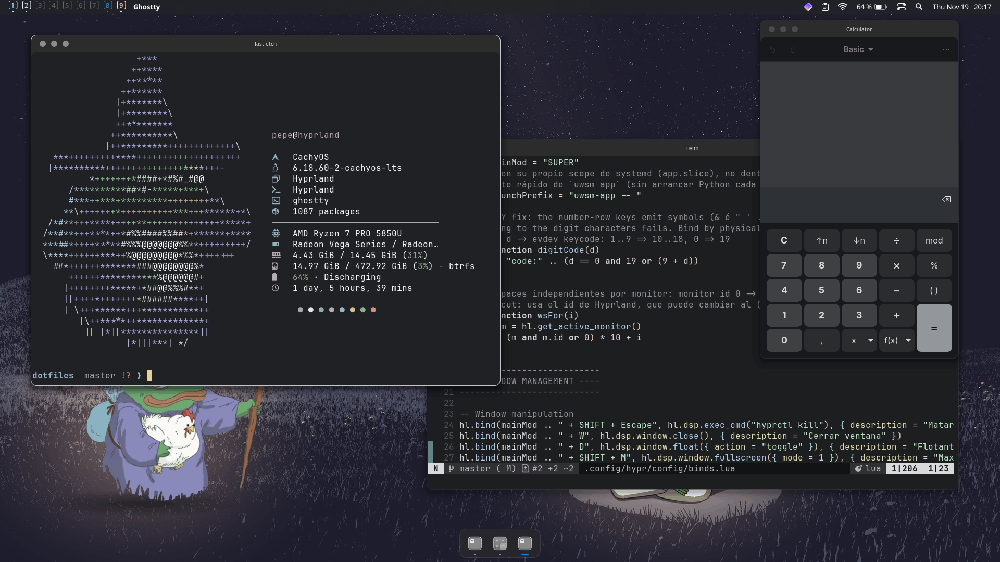
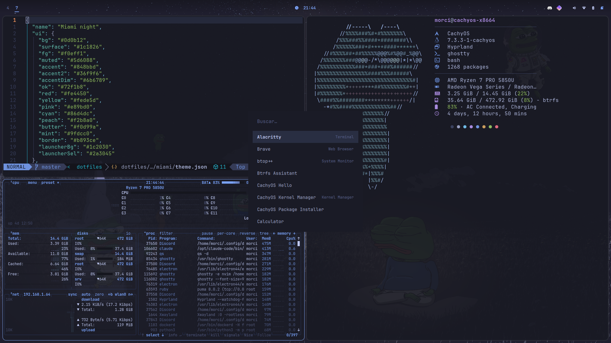
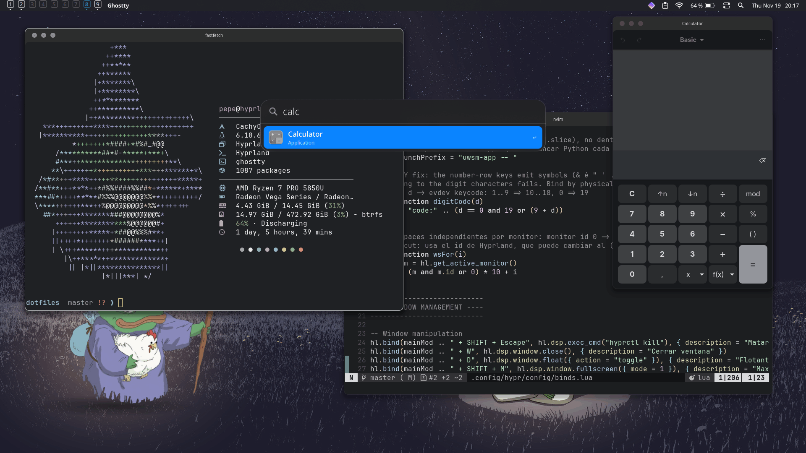

# dotfiles

My CachyOS desktop: **Hyprland** (Lua config) + **Quickshell** for everything else (bar, launcher, notifications, lock screen and dock).

Designed by me and implemented with help from [Claude Code](https://claude.com/claude-code).
[Omarchy](https://omarchy.org) was the inspiration for the desktop mode and the theme switcher.

It has **two desktop configs** you can switch between at any time, without logging out:

| Config Mac | Config Default |
|---|---|
|  |  |
| macOS-style top bar, Spotlight and control center (macshell), rounded windows with shadows, Sur icons | My original Quickshell bar and launcher, square windows, Papirus icons, colors from the active theme |

## What's inside

- **Hyprland 0.57 with a Lua config** (`.config/hypr/hyprland.lua` + `config/*.lua`), dwindle tiling,
  per-monitor workspaces and dimmed inactive windows (square corners in Default, rounded with shadows in Mac).
- **Quickshell** (`.config/quickshell`) replaces waybar, wofi, swaync, swayosd, hyprpaper and the polkit agent:
  bar, app launcher and menus (power, clipboard, emoji, themes, keybinding cheatsheet, wifi and bluetooth via dmenu),
  notifications, volume and brightness OSD, night light, wallpaper, lock screen and polkit dialog.
- **Per-workspace desktop mode**: on the workspaces you pick, windows float, can be minimized
  and a dock shows up at the bottom. In the bar, those workspaces have their number inside a box.
- **Two desktop configs, Mac and Default** (`config-set`): switch the whole look and the bar from a menu. See [below](#desktop-configs-mac--default).
- **macOS-style titlebars** on every floating window (close, minimize, maximize), using a patched `hyprbars` plugin.
- **Color theme switcher** (`.config/themes`): one `theme.json` per theme that colors Hyprland, Quickshell,
  hyprlock, ghostty, kitty, btop, GTK, Qt/KDE, fzf, fastfetch and running Neovims at once.
  Ships with kanagawa-dragon, everforest, miami, catppuccin, tokyo-night, rose-pine, gruvbox and vantablack. See `.config/themes/README.md`.
- **ghostty** as the terminal, bash + starship prompt, Neovim with LazyVim (own miami and vantablack colorschemes),
  btop, and fastfetch with a random ASCII Pepe tinted with the theme accent.



## Desktop configs: Mac / Default


**Super+Shift+T** opens the "Config" menu (the active one has a ✓), or from a terminal:

```sh
~/.config/themes/config-set mac       # macOS style
~/.config/themes/config-set default   # the original setup
~/.config/themes/config-set           # list them (* = active)
```

It applies in about 2 seconds: reloads Hyprland, restarts Quickshell and rewrites the icon and Qt settings.
Apps that are already open pick up the new icons and Qt style the next time you open them.

| | Config Mac | Config Default |
|---|---|---|
| Bar and notifications | macshell: macOS-style top bar, control center, notification center | Quickshell bar, notifications and dock from this repo |
| Super+Space | Spotlight | App launcher |
| Super+Esc / Super+A | macshell power menu / calendar and notifications | Power menu / notification center |
| Windows | 10 px rounded corners and a soft shadow | Square corners, default shadow |
| Titlebars (hyprbars) | Sur gray, Noto Sans, 32 px | Theme background, JetBrains Mono, 28 px |
| Icons (GTK, Qt) | Sur-Transparente | Papirus-Dark |
| Qt apps (qt6ct) | Breeze, `mac-dark` colors, Noto Sans | Fusion, colors from the active theme |



Shared by both: the color theme (Super+T), desktop mode, the rest of the keybindings, the cursor and the keyd keyboard layout.
In Mac, the color theme doesn't recolor Qt apps or the titlebars, to keep the macOS gray.

The active config is saved in `~/.local/state/desktop-profile`; `hypr/config/profile.lua` and `quickshell/shell.qml` read it.
**Mac needs macshell** (`~/.config/quickshell/macshell`), a separate Quickshell config that is not in this repo;
without it, Mac behaves like Default. Details in `.config/themes/README.md`.

## Desktop mode


- **Super+Alt+D** turns it on or off for the current workspace. New windows open floating, centered and at 65% of the screen.
- **Super+M** (or the yellow titlebar button) minimizes the window.
- **Dock** (auto-hides, hover the bottom edge): click a window to bring it to the front; click the active one to minimize it; click a minimized one to restore it.
- **Snapping**: drop a window against the left or right edge for half the screen, against the top to maximize. Dragging it away restores its size.
- Moving a window to a normal workspace puts it back in tiling.

It lives in `.config/hypr/config/desktopmode.lua` and `.config/quickshell/modules/Dock.qml`.

The titlebars need `hyprbars` built by hand with the patch in `.config/hypr/hyprbars-on-drag-end.patch`
(adds the drag hooks the snapping uses); the build steps are in a comment in `desktopmode.lua`.
Without the plugin everything else still works, just without titlebars.

## Keybindings

**Super+/** shows the full list on screen.

| Keys | Action |
|---|---|
| Super+Space | App launcher (Spotlight in Config Mac) |
| Super+Shift+Space | App launcher (in both configs) |
| Super+Enter | Terminal (ghostty) |
| Super+F | Files (Dolphin) |
| Super+Ctrl+T | Text editor |
| Super+Shift+C | Calculator |
| Ctrl+Shift+Esc | btop |
| Super+W | Close window |
| Super+Shift+Esc | Kill window (click it) |
| Super+H/J/K/L | Move focus |
| Super+Shift+H/J/K/L | Move window |
| Super+1…0 | Go to workspace |
| Super+Shift+1…0 | Send window to workspace |
| Super+Alt+1…0 | Go to workspace 11–20 (external monitor's), if it has windows |
| Super+Tab / Super+Shift+Tab | Focus other monitor / send window there |
| Super+D | Fullscreen |
| Super+Alt+Space | Toggle floating |
| Super+Alt+J | Toggle split direction |
| Super+Alt+D | Desktop mode on this workspace |
| Super+M | Minimize |
| Alt+Tab | Next window |
| Super+S / Super+Shift+S | Scratchpad: show / send window |
| Super+Plus / Super+Minus | Zoom in / out |
| Super+Esc | Power menu (macshell's in Config Mac) |
| Super+Ctrl+V | Clipboard history |
| Super+. | Emoji |
| Super+T | Switch theme |
| Super+Shift+T | Switch desktop config (Mac / Default) |
| Super+A | Notification center (macshell's in Config Mac) |
| Super+Alt+L | Lock |
| Super+Shift+P | Screenshot a region |
| Super+C / Super+V / Super+X | Copy / paste / cut in any app |

Workspace numbers are bound by keycode, so they also work on AZERTY keyboards.

## Installation

On a fresh CachyOS install:

```sh
git clone https://github.com/artiimor/dotfiles.git ~/dotfiles
~/dotfiles/install.sh        # asks before each step; --yes does everything
```

It installs the packages (plus `bzmenu` from the AUR), copies the dotfiles and web apps into `~`
(anything it overwrites goes to `~/.dotfiles-old/<date>`), applies a theme and the desktop config
(Default unless macshell is installed), builds the patched `hyprbars`
and, optionally, sets up the system parts in `system/`: greetd + ReGreet login, the Plymouth boot theme
and the keyd Alt/Super swap for the ThinkPad keyboard.

Or copy just what you want by hand:

```sh
cp -r dotfiles/.config/* ~/.config/
cp dotfiles/.bashrc dotfiles/.bash_profile ~/
```

Packages it uses: `hyprland` (0.57 or newer, for the Lua config), `quickshell`, `uwsm`, `ghostty`, `hypridle`,
`hyprlock` (as a fallback), `hyprsunset`, `hyprshot`, `cliphist`, `wl-clipboard`, `brightnessctl`, `playerctl`,
`wireplumber`, `power-profiles-daemon`, `networkmanager-dmenu`, `bzmenu`, `pavucontrol`, `dolphin`, `qt6ct`,
`papirus-icon-theme`, `starship`, `btop`, `fastfetch`, `neovim`, `python` (for `theme-set`) and the `ttf-jetbrains-mono-nerd` font.
Optional: `kitty` (also themed) and the `hyprbars` plugin.

After copying, run `~/.config/themes/theme-set miami` (or any other theme) to generate the color files,
then `~/.config/themes/config-set default` (or `mac` if you have macshell).

Things you'll probably want to change:

- `.config/hypr/config/variables.lua`: default apps and monitor names.
- `.config/hypr/config/inputs.lua`: keyboard layout (`us` altgr-intl). On my ThinkPad, Alt and Super are swapped with keyd (`system/etc/keyd`).
- `.config/quickshell/Theme.qml`: the wallpaper paths.
